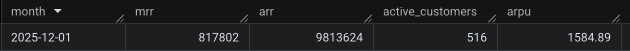
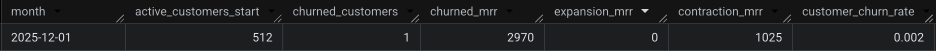
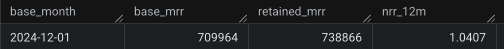

# SaaS Revenue ELT


## The problem

A SaaS finance team needs a monthly revenue number that does not move because an invoice is late or a payment fails. This pipeline loads customers, plans, subscriptions, invoices, and payments, and publishes revenue from the subscription and the catalog price. Invoices and payments are ingested, but they do not define the metric.

## Architecture

Parquet files are validated, stamped with `_run_date`, `_run_id`, and `_ingested_at` before upload, stored in GCS, and appended to BigQuery `raw`. Those metadata fields let the pipeline track which run produced each row, because the BigQuery load cannot add them later. dbt then builds `staging`, `intermediate`, and `marts`.

In the cloud, Cloud Scheduler starts a Cloud Run Job that runs `python -m src run-all`. Airflow in Docker is a local lab with the same shape, not the production orchestrator. Terraform owns the lake, the datasets, the Job, and the identity. A merge to `main` deploys the image and the infrastructure. It does not execute the load.

Detail is in [docs/ARCHITECTURE.md](docs/ARCHITECTURE.md).

## Decisions worth defending

Three choices that change what the numbers mean. The full record is in [docs/DECISIONS.md](docs/DECISIONS.md).

- **MRR uses today's catalog price.** Every month through `2025-12-31` is priced with the current `list_price` from `stg_plans`, not with a guaranteed historical sale-time price. `snapshot_plans` exists, but it only records plan changes from the day the snapshot starts running, so it cannot reconstruct prices for 2023–2025. Joining it today would therefore not make past MRR historically correct. `valid_from` and `valid_to` say when a subscription was active, not what the plan cost. If Pro goes from 20 to 30, the whole series is recalculated at 30. The snapshot becomes useful once that change has actually been captured.
- `raw` **is append-only.** Each run writes `_run_date`, `_run_id`, and `_ingested_at` and lands in its own GCS path. This preserves load history and avoids silent overwrites. Business history such as price or country is not modeled in the load layer. A retry uses a new `run_id`, because appending the same job twice would duplicate rows.
- **The monthly spine stops at `as_of_date`.** The source dump ends at `2025-12-31`, so the models are capped there instead of using the machine clock. This keeps churn and NRR reproducible: running the same snapshot in 2026 does not create extra empty months. If a row appears after the cutoff, the tests fail instead of stretching the series silently.


## What it publishes

The marts published today are single-currency `EUR`:

- `mart_revenue_monthly`: MRR, ARR, ARPU, active customers, and subscriptions with null quantity per month.
- `mart_mrr_movements`: `new`, `reactivation`, `expansion`, `contraction`, `churn`, and `flat` movements per customer-month.
- `mart_customer_churn`: logo churn, monetary churn, expansion, and contraction per month.
- `mart_nrr`: 12-month `NRR` by `base_month` cohort.

The published contract for grain, metrics, compatibility, PII, and SLA is in [docs/DATA_CONTRACT.md](docs/DATA_CONTRACT.md).

### As of December 2025

Catalog EUR, capped at `2025-12-31`. MRR and churn are that month. The NRR base month is December 2024, the latest cohort with a full 12-month window.



December 2025 catalog MRR is €817,802 across 516 active customers (€1,584.89 ARPU). ARR is that MRR times 12.



One of the 512 customers with MRR in November churned in December (0.2%), taking €2,970. Expansion that month was €0 and contraction was €1,025.



The December 2024 cohort retained €738,866 of €709,964 twelve months later: 104.1% NRR. Customers acquired after that month stay outside this ratio.

## How to check it

The local checks do not need a cloud project: `uv run pytest`, plus step 5 of the Quick start, which validates the parquet files against the raw contract. With a configured `.env` file and Google Application Default Credentials, `dbt build` runs the warehouse tests in BigQuery. Suites and commands are in [docs/TESTING.md](docs/TESTING.md).

## What I would do next

- Connect `snapshot_plans` to MRR only after a real price change exists to reconstruct.
- Keep the published marts as full-refresh tables until the source arrives as a real delta. Once the ingestion pattern and the data volume justify it, incremental models would be the next optimization step.


## Stack

- `Python 3.13` + `uv` for the load layer
- `pydantic` / `pydantic-settings` for configuration via `get_settings()`
- `google-cloud-storage` and `google-cloud-bigquery` for GCS and load jobs
- `dbt Core` + `dbt-bigquery` for warehouse transformations and tests
- `Terraform` for the lake, datasets, IAM, and cloud runtime
- `Airflow` in Docker Compose as a local orchestration lab


## What this repo does

- The orchestrator coordinates. Business logic stays in Python and dbt.
- dbt snapshots exist for SCD2, but the published marts still use the current state from `stg_plans` through intermediate models, not snapshot history.


## Operational safety

Some commands touch real GCS, BigQuery, or Terraform. In this repo:

- do not run `apply`, `seed-landing`, `run-all`, `run-raw-load`, or `dbt build`
against cloud without explicit OK;
- `dev` and `prod` are operated with runbooks kept separate from the `README`;
- remote backend, deploy, and the paused cron are detailed in  
`docs/OPERATIONS.md`.


## Quick start


### 1. Install dependencies

```bash
uv sync --group dev
```


### 2. Install local hooks

```bash
uv run pre-commit install
```


### 3. Check Python quality

```bash
uv run pytest
uv run ruff check .
uv run ruff format --check .
uv run mypy src
```


### 4. Check dbt without materializing

Create the local config before these commands. Both files are gitignored.

```bash
cp .env.example .env
mkdir -p ~/.dbt
cp dbt_project/profiles.yml.example ~/.dbt/profiles.yml
```

Edit `.env` and set `GCP_PROJECT_ID`, `GCS_BUCKET_NAME`, and `ENVIRONMENT` to the same stack. On Windows, copy the profile to `%USERPROFILE%\.dbt\profiles.yml`. The placeholders in `.env.example` are enough for step 5, which only checks local parquet. `dbt debug` opens a real BigQuery connection, so it also needs `gcloud auth application-default login` and a project you can access. `dbt compile` only renders SQL. Commands that load data stay in `docs/OPERATIONS.md`.

```bash
uv run --env-file .env dbt debug --project-dir dbt_project
uv run --env-file .env dbt compile --project-dir dbt_project
```


### 5. Validate raw inputs without uploading anything

```bash
uv run python -c "from src.settings import get_settings; from src.validation.raw_validation import validate_raw_inputs_or_raise; validate_raw_inputs_or_raise(get_settings())"
```


## Most used commands


### Quality and testing

```bash
uv run pytest
uv run ruff check .
uv run ruff format --check .
uv run mypy src
uv run sqlfluff lint dbt_project/models dbt_project/tests
```

Equivalent shortcuts:

```bash
make lint
make test
make hooks
```


### Raw pipeline

Validate local parquets:

```bash
uv run python -c "from src.settings import get_settings; from src.validation.raw_validation import validate_raw_inputs_or_raise; validate_raw_inputs_or_raise(get_settings())"
```

Load raw to GCS and BigQuery:

```bash
uv run python -m src run-raw-load
uv run python -m src run-raw-load --run-date YYYY-MM-DD
```

Seed `landing/` in GCS:

```bash
uv run python -m src seed-landing
make seed-landing
```

Run load + dbt:

```bash
uv run python -m src run-all
```


### dbt

```bash
uv run --env-file .env dbt seed --project-dir dbt_project
uv run --env-file .env dbt build --project-dir dbt_project
uv run --env-file .env dbt test --project-dir dbt_project
uv run --env-file .env dbt source freshness --project-dir dbt_project
```


### Docker and local Airflow

App image:

```bash
docker build -t saas-revenue-app .
```

Local Airflow:

Copy `.env.airflow.example` to `.env.airflow` and fill `AIRFLOW__CORE__FERNET_KEY`, `AIRFLOW__API_AUTH__JWT_SECRET`, `HOST_PROJECT_DIR`, and `HOST_GCP_ADC` as the comments in that example describe. Compose does not start without this file. Unpausing the DAG hits real GCS and BigQuery.

```bash
cp .env.airflow.example .env.airflow
docker build -t saas-revenue-airflow -f docker/airflow/Dockerfile docker/airflow
docker compose up --build
docker compose down
```

Detailed operations by environment, backend, and deploy are in
`docs/OPERATIONS.md`.

## Repo structure

- `src/`: settings, CLI, and load layer
- `config/`: raw contract and runtime policy
- `dbt_project/`: models, snapshots, tests, and seeds
- `terraform/`: cloud infrastructure and a separate `identity/` root
- `docs/`: architecture, decisions, contract, testing, and operations
- `tests/`: unit and integration tests for the load layer
- `dags/`: local orchestration lab


## Documentation

- Architecture: [docs/ARCHITECTURE.md](docs/ARCHITECTURE.md)
- Technical decisions: [docs/DECISIONS.md](docs/DECISIONS.md)
- Operations: [docs/OPERATIONS.md](docs/OPERATIONS.md)
- Data contract: [docs/DATA_CONTRACT.md](docs/DATA_CONTRACT.md)
- Testing guide: [docs/TESTING.md](docs/TESTING.md)


## Diagrams

- [Data flow](docs/images/data_flow.png)
- [Data layer](docs/images/data_layer.png)
- [GCP infrastructure](docs/images/gcp_infrastructure.png)
- [Commit to deploy](docs/images/commit_to_deploy.png)

If you open the repo for the first time, the recommended order is:

1. `README.md`
2. `docs/ARCHITECTURE.md`
3. `docs/DATA_CONTRACT.md`
4. `docs/OPERATIONS.md` only if you are going to touch cloud or deploy

