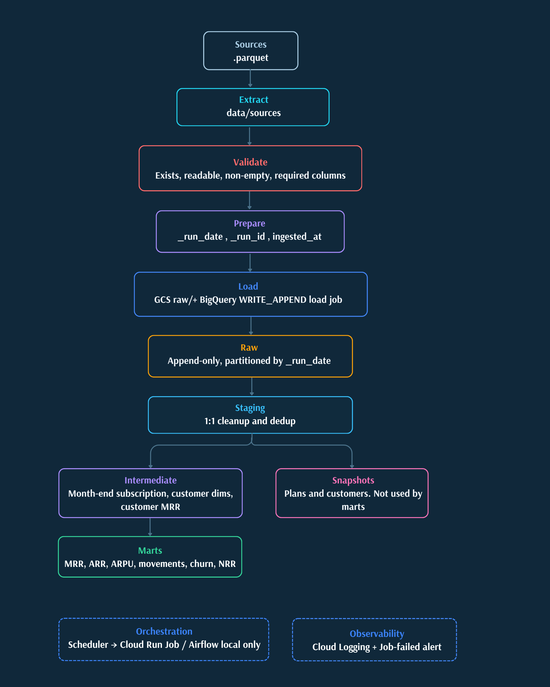

# SaaS Revenue ELT

ELT pipeline for a SaaS that loads customers, plans, subscriptions, invoices,  
and payments into BigQuery. Revenue metrics (`MRR`, `ARR`, `ARPU`, churn,  
movements, and `NRR`) come from the subscription and the catalog price.  
Invoicing and collection do not change them.



## Stack

- `Python 3.13` + `uv` for the load layer
- `pydantic` / `pydantic-settings` for configuration via `get_settings()`
- `google-cloud-storage` and `google-cloud-bigquery` for GCS and load jobs
- `dbt Core` + `dbt-bigquery` for warehouse transformations and tests
- `Terraform` for the lake, datasets, IAM, and cloud runtime
- `Airflow` in Docker Compose as a local orchestration lab


## What this repo does

The project flow is:

1. Validate raw parquets against the declared contract.
2. Enrich them with technical load metadata.
3. Upload them to GCS and load them into BigQuery `raw` with `WRITE_APPEND`.
4. Transform them with dbt by layer: `staging` -> `intermediate` -> `marts`.

Important design rules:

- Business history does not live in `raw`; `raw` is append-only with technical metadata.
- dbt snapshots exist for SCD2, but published marts still read `stg_*`, not `snapshot_*`.
- The orchestrator coordinates; business logic stays in Python and dbt.


## Operational safety

Some commands touch real GCS, BigQuery, or Terraform. In this repo:

- do not run `apply`, `seed-landing`, `run-all`, `run-raw-load`, or `dbt build`
against cloud without explicit OK;
- `dev` and `prod` are operated with runbooks kept separate from the `README`;
- remote backend, deploy, and the paused cron are detailed in  
`docs/OPERATIONS.md`.


## Quick start


### 1. Install dependencies

```bash
uv sync --group dev
```


### 2. Install local hooks

```bash
uv run pre-commit install
```


### 3. Check Python quality

```bash
uv run pytest
uv run ruff check .
uv run ruff format --check .
uv run mypy src
```


### 4. Check dbt without materializing

Create the local config before these commands. Both files are gitignored.

```bash
cp .env.example .env
mkdir -p ~/.dbt
cp dbt_project/profiles.yml.example ~/.dbt/profiles.yml
```

Edit `.env` and set `GCP_PROJECT_ID`, `GCS_BUCKET_NAME`, and `ENVIRONMENT` to the same stack. On Windows, copy the profile to `%USERPROFILE%\.dbt\profiles.yml`. The placeholders in `.env.example` are enough for step 5, which only checks local parquet. `dbt debug` opens a real BigQuery connection, so it also needs `gcloud auth application-default login` and a project you can access. `dbt compile` only renders SQL. Commands that load data stay in `docs/OPERATIONS.md`.

```bash
uv run --env-file .env dbt debug --project-dir dbt_project
uv run --env-file .env dbt compile --project-dir dbt_project
```


### 5. Validate raw inputs without uploading anything

```bash
uv run python -c "from src.settings import get_settings; from src.validation.raw_validation import validate_raw_inputs_or_raise; validate_raw_inputs_or_raise(get_settings())"
```


## Most used commands


### Quality and testing

```bash
uv run pytest
uv run ruff check .
uv run ruff format --check .
uv run mypy src
uv run sqlfluff lint dbt_project/models dbt_project/tests
```

Equivalent shortcuts:

```bash
make lint
make test
make hooks
```


### Raw pipeline

Validate local parquets:

```bash
uv run python -c "from src.settings import get_settings; from src.validation.raw_validation import validate_raw_inputs_or_raise; validate_raw_inputs_or_raise(get_settings())"
```

Load raw to GCS and BigQuery:

```bash
uv run python -m src run-raw-load
uv run python -m src run-raw-load --run-date YYYY-MM-DD
```

Seed `landing/` in GCS:

```bash
uv run python -m src seed-landing
make seed-landing
```

Run load + dbt:

```bash
uv run python -m src run-all
```


### dbt

```bash
uv run --env-file .env dbt seed --project-dir dbt_project
uv run --env-file .env dbt build --project-dir dbt_project
uv run --env-file .env dbt test --project-dir dbt_project
uv run --env-file .env dbt source freshness --project-dir dbt_project
```


### Docker and local Airflow

App image:

```bash
docker build -t saas-revenue-app .
```

Local Airflow:

Copy `.env.airflow.example` to `.env.airflow` and fill `AIRFLOW__CORE__FERNET_KEY`, `AIRFLOW__API_AUTH__JWT_SECRET`, `HOST_PROJECT_DIR`, and `HOST_GCP_ADC` as the comments in that example describe. Compose does not start without this file. Unpausing the DAG hits real GCS and BigQuery.

```bash
cp .env.airflow.example .env.airflow
docker build -t saas-revenue-airflow -f docker/airflow/Dockerfile docker/airflow
docker compose up --build
docker compose down
```

Detailed operations by environment, backend, and deploy are in
`docs/OPERATIONS.md`.

## Published outputs

The marts published today are:

- `mart_revenue_monthly`: MRR, ARR, ARPU, active customers, and subscriptions with null quantity per month.
- `mart_mrr_movements`: `new`, `reactivation`, `expansion`,
`contraction`, `churn`, and `flat` movements per customer-month.
- `mart_customer_churn`: logo churn, monetary churn, expansion, and contraction
per month.
- `mart_nrr`: 12-month `NRR` by `base_month` cohort.

The published contract for grain, metrics, compatibility, PII, and SLA is in
`docs/DATA_CONTRACT.md`.

## Repo structure

- `src/`: settings, CLI, and load layer
- `config/`: raw contract and runtime policy
- `dbt_project/`: models, snapshots, tests, and seeds
- `terraform/`: cloud infrastructure and a separate `identity/` root
- `docs/`: architecture, decisions, contract, testing, and operations
- `tests/`: unit and integration tests for the load layer
- `dags/`: local orchestration lab


## Documentation

- Architecture: [docs/ARCHITECTURE.md](docs/ARCHITECTURE.md)
- Technical decisions: [docs/DECISIONS.md](docs/DECISIONS.md)
- Operations: [docs/OPERATIONS.md](docs/OPERATIONS.md)
- Data contract: [docs/DATA_CONTRACT.md](docs/DATA_CONTRACT.md)
- Testing guide: [docs/TESTING.md](docs/TESTING.md)


## Diagrams

- [Data flow](docs/images/data_flow.png)
- [Data layer](docs/images/data_layer.png)
- [GCP infrastructure](docs/images/gcp_infrastructure.png)
- [Commit to deploy](docs/images/commit_to_deploy.png)

If you open the repo for the first time, the recommended order is:

1. `README.md`
2. `docs/ARCHITECTURE.md`
3. `docs/DATA_CONTRACT.md`
4. `docs/OPERATIONS.md` only if you are going to touch cloud or deploy

