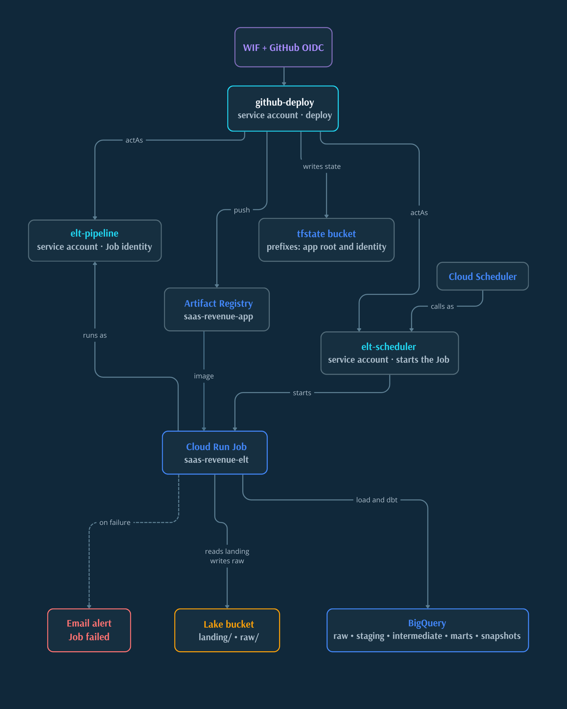
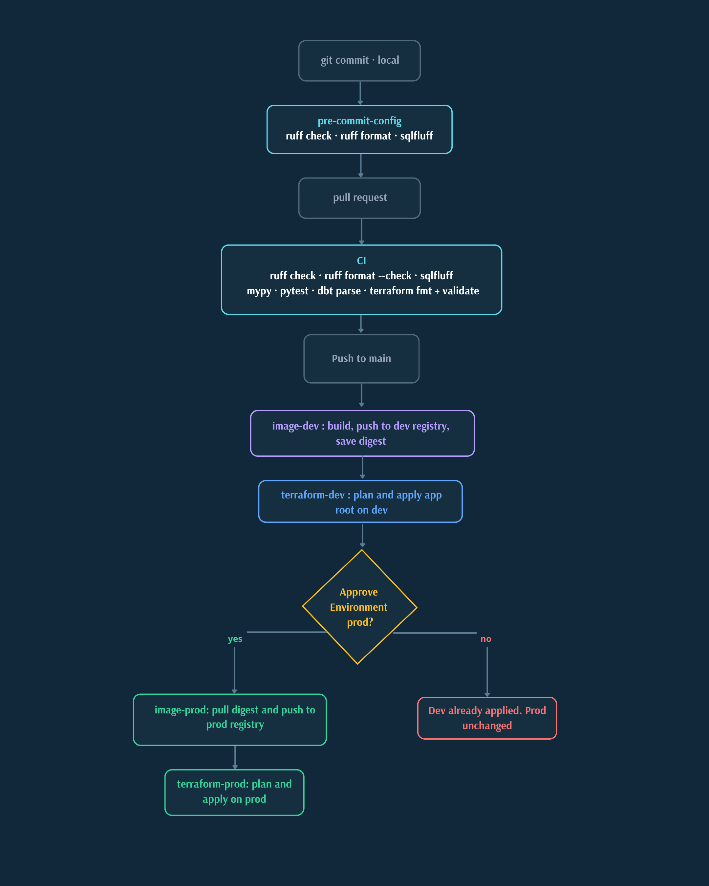

# Operations

This document holds the project's **operational guide**: Terraform,
`dev` and `prod` environments, deploy, Cloud Run Job, Scheduler, alerts, and
commands that touch GCP.

If you only want to understand the system, go back to `README.md` and
`ARCHITECTURE.md`. Open this document when you are going to **operate** the stack.

## What it covers

It answers these questions:

- how to initialize the remote Terraform backend;
- how to switch between `dev` and `prod` without mixing state;
- how to deploy infrastructure and the app image;
- how to seed `landing/` and run the pipeline against cloud;
- how the Job, the Scheduler, and the failure alert work.

## Operational safety

This repo touches real GCP resources. Before running commands from this guide:

- do not run `terraform apply`, `seed-landing`, `run-raw-load`, `run-all`, or
  `dbt build` against cloud without explicit OK;
- remember that a merge to `main` deploys to `dev`, but **does not execute** the ELT;
- the Scheduler is born paused and must not be unpaused without `landing/` seeded
  and explicit OK;
- `terraform/identity` is operated apart from the main root.

## Environment model

The project uses **two GCP projects**, not Terraform workspaces:

- `prod`: project with data
- `dev`: separate sandbox

Invariants:

- datasets are still named `raw`, `staging`, `intermediate`, `marts`, and
  `snapshots` in both environments;
- state lives in a GCS bucket separate from the data lake;
- switching environments means switching `backend-<env>.hcl` and
  `envs/<env>.tfvars`, not renaming datasets or moving dbt code.

Inside each project the shape is the same:

<p align="center">
  
</p>

## Terraform

### Important files

- `terraform/backend.tf`: declares `backend "gcs" {}`
- `terraform/backend-prod.hcl.example` and `terraform/backend-dev.hcl.example`:
  real backend per environment
- `terraform/envs/prod.tfvars.example` and `terraform/envs/dev.tfvars.example`:
  inputs per environment
- `terraform/identity/`: separate root for WIF and sensitive IAM

### Initial setup

From `terraform/`, copy local templates:

```bash
cp envs/prod.tfvars.example envs/prod.tfvars
cp envs/dev.tfvars.example envs/dev.tfvars
cp backend-prod.hcl.example backend-prod.hcl
cp backend-dev.hcl.example backend-dev.hcl
```

The state bucket must exist before the first `terraform init`.

### Switch between environments

Always use `-reconfigure`, not `-migrate-state`:

```bash
cd terraform

terraform init -reconfigure -backend-config=backend-dev.hcl
terraform plan -var-file=envs/dev.tfvars

terraform init -reconfigure -backend-config=backend-prod.hcl
terraform plan -var-file=envs/prod.tfvars
```

Operational rule:

- `-reconfigure` changes which state the local folder is looking at;
- `-migrate-state` would try to copy maps between environments and is not used here.

### Apply of the main root

Only with explicit OK:

```bash
cd terraform

terraform init -reconfigure -backend-config=backend-dev.hcl
terraform apply -var-file=envs/dev.tfvars

terraform init -reconfigure -backend-config=backend-prod.hcl
terraform apply -var-file=envs/prod.tfvars
```

This root provisions the lake, datasets, Artifact Registry, Cloud Run Job,
Scheduler, and monitoring. It does not provision the GitHub identity.

## Identity and WIF

`terraform/identity/` is a separate root and is applied locally with ADC.

Responsibility of this root:

- create WIF for GitHub;
- create `github-deploy`;
- create `elt-pipeline`;
- assign sensitive IAM outside the scope of CD.

`deploy.yml` does **not** apply `terraform/identity`. Identity is prepared
locally first; then the workflow can apply the main root.

## Deploy

<p align="center">
  
</p>

### What CI does

`.github/workflows/ci.yml`:

- Python and SQL lint;
- pytest;
- `terraform fmt` and `terraform validate`;
- `dbt deps` + `dbt parse`.

CI does not run `plan`, `apply`, or real data.

### What CD does

`.github/workflows/deploy.yml`:

- build the app image;
- push to the `dev` registry with the SHA tag;
- `terraform apply` of the main root in `dev`;
- promotion to `prod` by copying the `dev` digest, not by rebuilding the image;
- `terraform apply` in `prod` after a reviewer.

The deploy leaves the Job, the paused Scheduler, and the alert configured. It does not call
the `:run` endpoint.

## Running data

### Validate without touching cloud

```bash
uv run python -c "from src.settings import get_settings; from src.validation.raw_validation import validate_raw_inputs_or_raise; validate_raw_inputs_or_raise(get_settings())"
```

### Seed `landing/`

Required so the cloud Job can read the current dump:

```bash
uv run python -m src seed-landing
make seed-landing
```

This copies `data/sources/*.parquet` to `gs://<lake>/landing/`.

### Load raw

```bash
uv run python -m src run-raw-load
uv run python -m src run-raw-load --run-date YYYY-MM-DD
```

It does validate -> prepare -> GCS -> BigQuery `raw`.

### Load raw + dbt

```bash
uv run python -m src run-all
```

It does the raw load and then dbt in the same process.

### dbt in the warehouse

```bash
uv run --env-file .env dbt seed --project-dir dbt_project
uv run --env-file .env dbt build --project-dir dbt_project
uv run --env-file .env dbt test --project-dir dbt_project
uv run --env-file .env dbt source freshness --project-dir dbt_project
```

## `dev` vs `prod` when running data

Terraform and `.env` solve different problems:

- Terraform decides which infrastructure exists and which state you are looking at.
- `.env` decides which project and bucket the Python/dbt runtime points at.

To reproduce the dump in `dev`:

1. align `GCP_PROJECT_ID`, `GCS_BUCKET_NAME`, and `ENVIRONMENT=dev` in `.env`;
2. run `run-raw-load` or `run-all`;
3. restore the `prod` values when finished.

Changing the Terraform backend does **not** automatically redirect `run-all`.

## Cloud Run Job

The app image packages Python + dbt. In cloud:

- the Job uses `RAW_SOURCE=gcs`;
- it reads from `gs://<lake>/landing/`;
- it copies the dump to a temp directory before validating;
- it runs `python -m src run-all`.

Without `landing/` seeded, the Job fails on the initial fetch.

## Scheduler

The Scheduler:

- calls the Job's `:run` endpoint;
- uses a separate service account (`elt-scheduler`);
- is born with `paused = true`;
- does not retry by default (`retry_count = 0`).

The operational decision is deliberate: with a frozen dump, an active cron
would only generate new `run_id`s and rewrite marts with the same facts.

## Alerts

The current alert:

- uses an email channel;
- watches failed Job executions;
- requires `GCP_ALERT_EMAIL` in the corresponding Environment.

The Job is not fired automatically as an "alert test"; verifying the
email in GCP is still required.

## Local Airflow

Airflow remains a local lab, not the productive cloud path.

```bash
docker build -t saas-revenue-app .
docker build -t saas-revenue-airflow -f docker/airflow/Dockerfile docker/airflow
docker compose up --build
docker compose down
```

The DAG appears paused and uses the app image via `DockerOperator`.

## Where to go deeper

- `README.md`: entry point and frequent commands
- `ARCHITECTURE.md`: mental map of the system
- `DECISIONS.md`: reasons and trade-offs
- `DATA_CONTRACT.md`: published data contract
- `TESTING.md`: test strategy and commands
